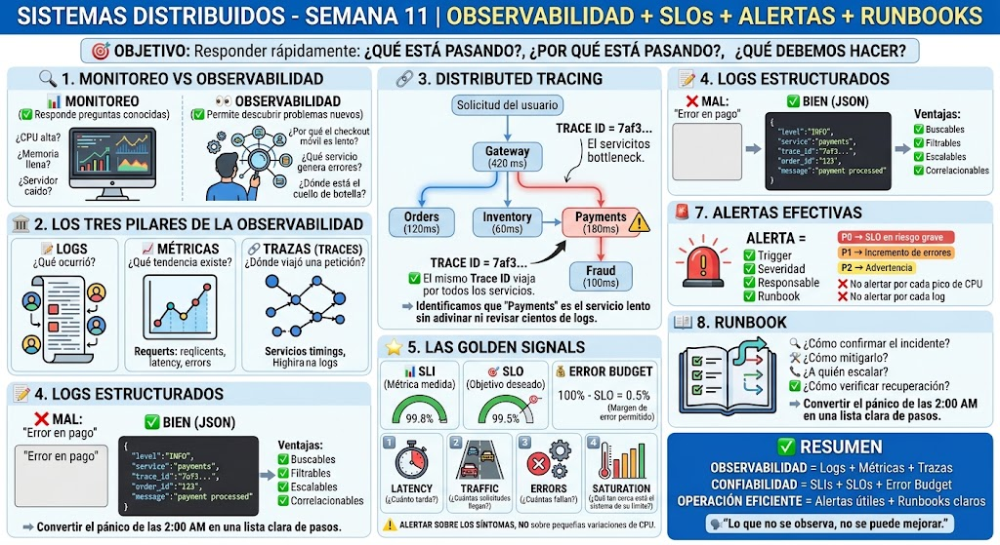

<!-- HU-STATUS TEMPLATE - do NOT remove the <!-- ... --> markers or the table headers.
     Your weekly grade is read AUTOMATICALLY from this file:
       11-week/hu-status/README.md  (inside YOUR fork). English. -->

# Weekly Status - Week 11

<!-- CONFIG-START - must match your profile repo (username/username) CONFIG -->
- FULL_NAME: Carlos Mauricio Leal Medina
- GITHUB_USER: carlosleal16
- TEAM: Barberssas
- SPRINT_GOAL: After the checkpoint-2 delivery (release `v2.0.0`, 2026-10-09), study the week's topic (observability, SLIs/SLOs, alerts and runbooks) and check it against my three services (`notifications-api`, `barbershop-api`, `schedule-api`), so that next week starts from a written list of what each one already has and what it is missing.
<!-- CONFIG-END -->

## 1. User stories worked this week
| HU ID | Title | Status (todo/doing/done) | Evidence (PR or commit URL) |
|---|---|---|---|
| HU-AUTH-002 | As a client, barber or admin who forgot my password, I want a 6-digit code sent to my e-mail, so that I can set a new password without exposing whether my e-mail is registered | doing (Dev). The last fix is in `develop` and still has to be promoted to `qa` | `notifications-api` [#16](https://github.com/code-corhuila/barber-saas-notifications-api/pull/16) (merged 2026-10-09, reported in week 10; commits `3d97edc` test → `d76f7d5` fix). Refs [`barber-saas-docs#6`](https://github.com/code-corhuila/barber-saas-docs/issues/6) |
| HU-SEC-001 | As the team, we want each service to refuse to start without its required variables and every commit scanned for secrets, so that no service runs half-configured and no secret reaches the remote | doing (partly done in week 09: `.env.example`, `.gitignore`, secrets read from the environment) | No commit this week. Missing: fail-fast validation and the pre-commit secret scan |

> **No new code this week.** Between 2026-10-12 and 2026-10-18 I have no commits, pull requests,
> issues or reviews in `code-corhuila`. The last ones are the release 2.0.0 pull requests and
> `notifications-api#16`, all from 2026-10-09 and already reported in week 10. This week's work was
> the observability session and the review of my services against it (section 2). The only team
> commit of the week is Daniel Cerquera's
> [`barber-saas-docs@5ecc03e`](https://github.com/code-corhuila/barber-saas-docs/commit/5ecc03e)
> (2026-10-13), which links the `v2.0.0` demo video in `15-project-control/sprint-status.md`.

## 2. My individual contribution
- **Observability session (sessions 1 and 2).** The session covered monitoring vs observability,
  the three pillars (logs, metrics, traces), distributed tracing with one trace id across services,
  structured JSON logs, the golden signals with SLI, SLO and error budget, effective alerts
  (trigger, severity, owner, runbook) and runbooks. My summary is the infographic below.

  

- **Review of my three services against the session**, read on `origin/develop` (no code changed):

  | Session topic | `notifications-api` (Python) | `barbershop-api` / `schedule-api` (Java) |
  |---|---|---|
  | One id across services (tracing) | yes: `X-Correlation-Id` is reused or generated, returned and used as the error `traceId` (`adapter/inbound/http/correlation.py`) | yes: `CorrelationFilter` puts `correlationId` in the MDC and in `ApiError` |
  | Structured logs (JSON) | yes: every log line is JSON and carries the correlation id | **no**: plain-text Spring Boot logs; the id is in the MDC but not in a JSON line |
  | Health | yes | yes: `HealthController` |
  | Metrics (latency, traffic, errors, saturation) | **no** | **no**: no Actuator/Micrometer endpoint |
  | SLI / SLO / error budget | **no** | **no** |
  | Alerts and runbooks | **no** | **no** |

  The correlation id already does what the session's tracing example shows (one id in every
  service of a request), so a slow or failing call can be followed through the gateway, the
  worker and my services. What is missing is the metrics side: without latency and error metrics
  there is nothing to measure an SLO against or to alert on.

## 3. Blockers and risks
- **No delivery this week.** The week after the checkpoint went to the class topic; no story
  moved. The rest of HU-SEC-001 (fail-fast validation and the secret scan) has been open since week 09.
- **`notifications-api#16` is only in Dev.** The expired-code fix is in `develop` but not in `qa`
  or `main`, so the release `v2.0.0` still answers `503` to an expired reset code when no mail
  server is configured.
- **Observability work has no story yet.** There is no HU in `barber-saas-docs` for metrics,
  SLOs or runbooks. Under norm 9.1 a pull request needs its `barber-saas-docs#NN`, so the issue
  has to exist before the code.
- **Plain-text logs in the Java services.** Today a `barbershop-api` or `schedule-api` log line
  cannot be filtered by `correlationId` the way the JSON logs of `notifications-api` can.

## 4. Plan for next week
- Promote `notifications-api#16` to `qa`: one story in one promotion pull request, with
  `git cherry-pick -x` and under 400 lines.
- Open an observability issue in `barber-saas-docs` for my three services: JSON logs in
  `barbershop-api` and `schedule-api`, latency and error metrics, one SLO per service (e.g.
  availability of the booking slots in `schedule-api`) and a short runbook in each README.
- Start with the JSON logs of the Java services, test first, since they are the smallest change.
- HU-SEC-001 in my services: fail-fast validation of required variables and a pre-commit secret
  scan.

## 5. Compliance self-check
- [ ] Conventional Commits - `type(scope): summary`: no commits in the project repositories this
      week. The only commit is this delivery in the weekly repository.
- [ ] Per-environment HU branch + PR to that environment (hu-xxx-dev -> develop, ...): no pull
      requests this week; the promotion of #16 to `qa` is planned.
- [x] Testable acceptance criteria: the planned observability story is written with checks that
      can be verified (a JSON line with `correlationId`, a metrics endpoint, a written SLO).
- [ ] Tests added/updated (unit / integration): none this week.
- [x] DDD / hexagonal boundaries respected (domain has no I/O): unchanged. Logging and correlation
      live in the inbound HTTP adapters, not in the domain.
- [x] No secrets; config via environment variables: unchanged; nothing was committed.

## 6. Evidence links
- Session infographic: [`week11-session1-2.jpg`](week11-session1-2.jpg)
- [`notifications-api#16`](https://github.com/code-corhuila/barber-saas-notifications-api/pull/16): last fix of HU-AUTH-002, merged to `develop` on 2026-10-09, pending promotion
- Correlation id in my services: [`notifications-api` `correlation.py`](https://github.com/code-corhuila/barber-saas-notifications-api/blob/develop/src/notifications/adapter/inbound/http/correlation.py), [`barbershop-api` `CorrelationFilter.java`](https://github.com/code-corhuila/barber-saas-barbershop-api/blob/develop/barbershop-adapters/src/main/java/co/edu/corhuila/barbersaas/barbershop/adapter/in/http/CorrelationFilter.java), [`schedule-api` `CorrelationFilter.java`](https://github.com/code-corhuila/barber-saas-schedule-api/blob/develop/schedule-adapters/src/main/java/co/edu/corhuila/barbersaas/schedule/adapter/in/http/CorrelationFilter.java)
- Team commit of the week: [`barber-saas-docs@5ecc03e`](https://github.com/code-corhuila/barber-saas-docs/commit/5ecc03e) (link to the `v2.0.0` demo video)
- Issue [`#6`](https://github.com/code-corhuila/barber-saas-docs/issues/6): HU-AUTH-002
