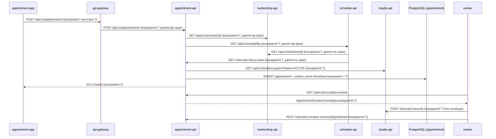

# CP1 - Critical journey and trace map

## Journey: a client books an appointment

A `CLIENT` picks a barber, a service and a free slot, and books it with
`POST /api/v1/appointments` (`bookAppointment`). It is the core flow of BarberSaaS and it crosses
five components: `api-gateway`, `appointment-api`, `barbershop-api`, `schedule-api` and, after
the commit, the `worker` relaying `AppointmentCreated` to `loyalty-api`.

Sources in `barber-saas-docs`:

- `07-api/contracts/openapi/appointment-service.yaml` (`bookAppointment`, `INV-APPT-001`,
  `INV-APPT-002`, `DEC-APPT-03`, `DEC-APPT-05`, `DEC-APPT-07`, `DEC-APPT-09`)
- `07-api/contracts/openapi/schedule-service.yaml` (`getAvailability`, `DEC-SCHED-03`)
- `09-microservices/communication-patterns.md` and `dependency-map.md`
- `09-microservices/event-catalog.md` (`AppointmentCreated` v2, consumer `loyalty-api`)
- `06-data/models.md` (tables `appointment.appointment` and `appointment.outbox_event`)
- ADR-016: no message broker; outbox plus worker relay over internal HTTP

## Hop table

| Step | Caller | Callee | Protocol | Operation | Sync/Async | Data |
|---|---|---|---|---|---|---|
| 1 | appointment-app (in `barber-saas-front` shell) | api-gateway | REST | `POST /api/v1/appointments` | sync | none |
| 2 | api-gateway | appointment-api | REST | `POST /api/v1/appointments` | sync | none |
| 3 | appointment-api | barbershop-api | REST | `GET /api/v1/services/{id}` (price, duration) | sync | `barbershop` schema |
| 4 | appointment-api | schedule-api | REST | `GET /api/v1/availability?barberId&serviceId&date` | sync | `schedule` schema |
| 5 | schedule-api | barbershop-api | REST | `GET /api/v1/barbers/{id}` | sync | `barbershop` schema |
| 6 | schedule-api | appointment-api | REST | `GET /internal/v1/busy-slots` (ADR-015) | sync | `appointment` schema |
| 7 | appointment-api | loyalty-api | REST | `GET /api/v1/loyalty/coupons?status=ACTIVE` | sync | `loyalty` schema |
| 8 | appointment-api | PostgreSQL | SQL | `INSERT appointment` + `INSERT outbox_event` (one transaction) | sync | `appointment` schema |
| 9 | worker | appointment-api | REST | `GET /internal/v1/outbox-events` (relay poll) | async | `appointment.outbox_event` |
| 10 | worker | loyalty-api | REST | `POST /internal/v1/events` (`AppointmentCreated`) | async | `loyalty.processed_event` |
| 11 | worker | appointment-api | REST | `POST /internal/v1/outbox-events/{id}/published` | async | `appointment.outbox_event` |

Hop 4 (appointment-api to schedule-api) is the downstream dependency used in the CP9 incident
drill: if it is slow, every booking is slow, because the start must be a slot that schedule offers.

## How the trace context travels

- **HTTP hops (1 to 7):** the W3C `traceparent` header
  (`00-<trace_id>-<parent span_id>-01`), next to the `X-Correlation-Id` the services already send
  (`communication-patterns.md`). The gateway creates the trace if the app did not send one.
- **Asynchronous boundary (8 to 11):** there is no broker, so the context cannot ride in a message
  header. appointment-api writes `traceparent` inside the `EventEnvelope` stored in
  `outbox_event`, in the same transaction as the appointment, next to `correlationId`. The worker
  reads it back and sends it as the `traceparent` header of `POST /internal/v1/events`, so the
  loyalty-api span keeps the same `trace_id`.

## Sequence diagram

## Span tree

All spans share the same `trace_id` T.

- `api-gateway POST /api/v1/appointments` (root span, SERVER)
  - `appointment-api bookAppointment` (SERVER)
    - `appointment-api GET barbershop-api /api/v1/services/{id}` (CLIENT)
      - `barbershop-api GET /api/v1/services/{id}` (SERVER)
    - `appointment-api GET schedule-api /api/v1/availability` (CLIENT)
      - `schedule-api getAvailability` (SERVER)
        - `schedule-api GET barbershop-api /api/v1/barbers/{id}` (CLIENT)
          - `barbershop-api GET /api/v1/barbers/{id}` (SERVER)
        - `schedule-api GET appointment-api /internal/v1/busy-slots` (CLIENT)
          - `appointment-api GET /internal/v1/busy-slots` (SERVER)
    - `appointment-api GET loyalty-api /api/v1/loyalty/coupons` (CLIENT)
      - `loyalty-api GET /api/v1/loyalty/coupons` (SERVER)
    - `appointment-api INSERT appointment + outbox_event` (INTERNAL, DB)
  - `worker relay AppointmentCreated` (CONSUMER, crosses the async boundary, parent read from
    `outbox_event` envelope)
    - `worker POST loyalty-api /internal/v1/events` (CLIENT)
      - `loyalty-api receiveEvent AppointmentCreated` (SERVER, coupon becomes `USED`, `DEC-LOY-06`)
    - `worker POST appointment-api /internal/v1/outbox-events/{id}/published` (CLIENT)
