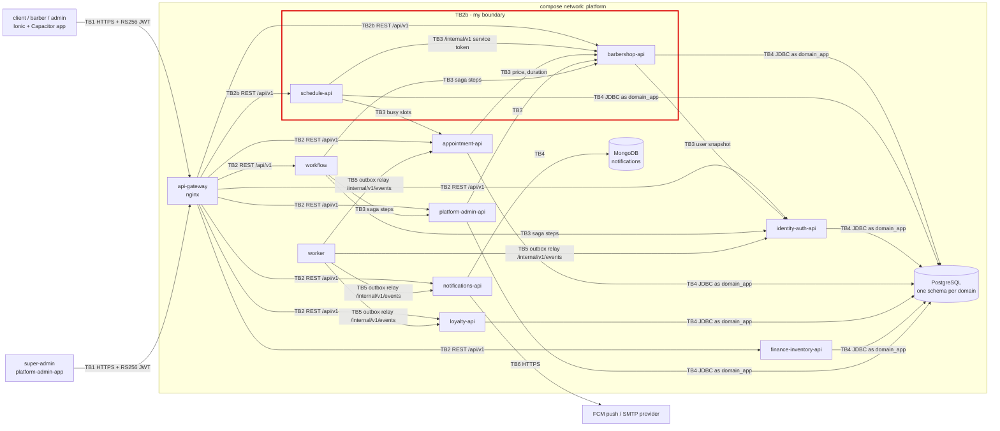

# CP1 - Attack surface map

Sources: `barber-saas-docs` (`09-microservices/dependency-map.md`, `communication-patterns.md`,
`data-ownership-matrix.md`, `07-api/authentication.md`) and the route files of `barber-saas-api-gateway`
(`nginx/routes/barbershop.conf`, `nginx/routes/schedule.conf`).

## Data flow and trust boundaries

My boundary is **TB2b**: `api-gateway` → `barbershop-api` / `schedule-api` (red).
BarberSaaS has no message broker: events go through each producer's `outbox_event` table and the
`worker` relays them to `POST /internal/v1/events`.

Rendered image of the same diagram: [`01-attack-surface.png`](01-attack-surface.png).

| Id | Boundary | Why the trust changes |
|---|---|---|
| TB1 | Internet → `api-gateway` | Anyone on the internet can send a request |
| TB2 | `api-gateway` → domain services | The gateway only checks that a token exists, not that it is valid |
| **TB2b** | **`api-gateway` → `barbershop-api` / `schedule-api`** | **Mine. Part of the catalog is anonymous; the rest depends on the token's role and `barbershopId`** |
| TB3 | service → service on `/internal/v1/**` | The caller uses its own service token (`role: SERVICE`) |
| TB4 | service → its own schema | Each service connects as `<domain>_app`, never as admin |
| TB5 | `worker` → `/internal/v1/events` | Events from the outbox reach another domain |
| TB6 | `notifications-api` → FCM / SMTP | The data leaves our network |

## Asset inventory (my boundary)

| Asset | Where it lives | Classification |
|---|---|---|
| RS256 access token (`sub`, `role`, `barbershopId`) | `Authorization` header from the app, through the gateway, to both services | Restricted |
| `barbershopId` claim (the tenant) | Token; used as the filter on every tenant table (`barbershop.service`, `barber_profile`, `barber_schedule`, `schedule_exception`) | Restricted (integrity) |
| Barber profile (`full_name`, `profile_photo_url`) | `barbershop.barber_profile` | Confidential |
| Service catalog (name, price, duration) | `barbershop.service`; anonymous through `GET /api/v1/barbershops/{id}/services` | Public |
| Barbershop status, trial and `plan_id` | `barbershop.barbershop` | Internal |
| Weekly schedule and exceptions (days off, absences) | `schedule.barber_schedule`, `schedule.schedule_exception` | Internal |
| Free slots | Computed by `schedule-api`, never stored | Internal |
| DB credentials of `barbershop_app` / `schedule_app` | Environment variables of each service | Restricted |

## Entry points of TB2b

Today `api-gateway` only rejects a protected route with no `Authorization` header (`$missing_auth`)
and applies `limit_req zone=per_client` (10 r/s per IP). The real check is in each service:
`AuthFilter` + `Rs256Verifier` validate the signature and expiry, and the use case checks the role
(`ManageBarbershops`, `ManageServices`, `ManageBarbers`, `ManageWeeklySchedules`,
`ManageExceptions`, `QueryAvailability`).

| Entry point | Service | Who calls it | Authentication today |
|---|---|---|---|
| `GET /api/v1/barbershops`, `GET /api/v1/barbershops/{id}`, `/{id}/services`, `/{id}/barbers` | barbershop-api | Anyone (discovery catalog, DEC-SHOP-02) | **None** (anonymous); rate limit only |
| `GET`, `PATCH /api/v1/barbershops/me` | barbershop-api | Barbershop admin | JWT; role `ADMIN_BARBERSHOP` in `ManageBarbershops` |
| `GET`, `POST /api/v1/services`, `GET`, `PUT /api/v1/services/{id}` | barbershop-api | Admin (write), staff (read) | JWT; role in `ManageServices`; tenant from the token |
| `GET`, `POST /api/v1/barbers`, `GET`, `PATCH /api/v1/barbers/{id}`, `/{id}/specialties` | barbershop-api | Admin, barber | JWT; role in `ManageBarbers`; tenant from the token |
| `GET`, `PUT /api/v1/barber-schedules/{barberId}` | schedule-api | Admin, the barber | JWT; role in `ManageWeeklySchedules` |
| `GET`, `POST /api/v1/schedule-exceptions`, `GET`, `DELETE /{id}` | schedule-api | Admin, the barber | JWT; role in `ManageExceptions` |
| `GET /api/v1/availability` | schedule-api | Client while booking | JWT (the tenant comes from it); wider burst (40) in the gateway |
| Port `8080` of both containers | both | Any container on the `platform` network | `expose`, not `ports`: not reachable from the host, but reachable from inside the network |

`/internal/v1/barbershops` (saga and platform operations) is never routed by the gateway, so it is
outside TB2b. It belongs to TB3.
