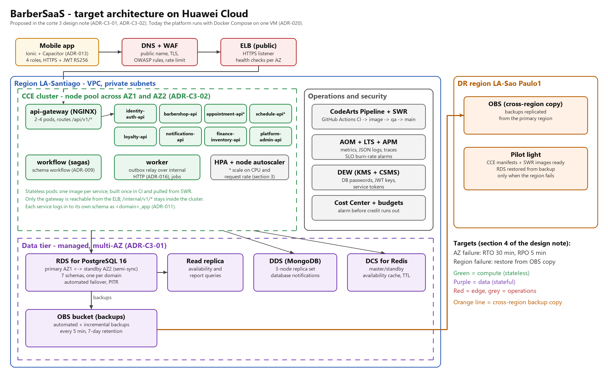

# Architecture design note — Barberssas (BarberSaaS)

## 1. Target architecture

BarberSaaS is a multi-tenant platform for barbershops: clients book appointments, barbers manage their
schedule, owners manage their shop and plan, and a platform admin operates the SaaS. Today the whole
platform runs with Docker Compose on one Azure for Students VM (ADR-020): one container per service, one
PostgreSQL instance and one MongoDB instance on the same disk. That was the right call to deliver the
course on time with no money, but it puts every service, every database and every backup on one machine
in one zone. The diagram above is the target I designed with the course: the same services and the same
domain boundaries, moved to Huawei Cloud managed services so that one failed machine or zone does not
stop the business. The service boundaries do not change; only where and how they run changes.

| Component in the diagram | Defined in (file of your team's -docs) |
|---|---|
| Mobile app (Ionic + Capacitor, Angular shell) | 05-architecture/decisions/records/ADR-013-hybrid-mobile-interface.md |
| api-gateway (NGINX), only public entry | 05-architecture/deployment.md |
| Eight domain services (identity-auth, barbershop, appointment, schedule, loyalty, notifications, finance-inventory, platform-admin) | 09-microservices/service-catalog.md |
| workflow (sagas, schema `workflow`) | 05-architecture/decisions/records/ADR-009-saga-state-store.md |
| worker (outbox relay over internal HTTP) | 05-architecture/decisions/records/ADR-016-event-transport-worker-relay.md |
| PostgreSQL, one schema per domain, one application user per domain (for example `schedule_app`) | 05-architecture/decisions/records/ADR-011-single-instance-per-engine.md |
| MongoDB for notifications | 05-architecture/decisions/records/ADR-006-database-engine-per-domain.md |
| Availability computation (schedule asks appointment for busy slots) | 05-architecture/decisions/records/ADR-015-availability-busy-slots.md |
| Logs, metrics and traces | 13-operations/observability.md |
| Current host that the target replaces | 05-architecture/decisions/records/ADR-020-hosting-azure-for-students.md |

## 2. Five principles

| Principle | Current weakness | Evidence in -docs | Design decision | Huawei Cloud service |
|---|---|---|---|---|
| Reliability | One VM in one zone runs every container and both databases; most containers have no restart policy, and while the VM is stopped nothing answers. | 05-architecture/decisions/records/ADR-020-hosting-azure-for-students.md | Spread stateless pods over two availability zones behind a load balancer, and move PostgreSQL and MongoDB to managed primary/standby instances with automatic failover (ADR-C3-01, ADR-C3-02). | ELB, CCE, RDS for PostgreSQL, DDS |
| Security | TLS ends in Caddy on the same VM, there is no web application firewall, and the database passwords, JWT keys and service tokens live in `env/main.env` on the VM disk. | 05-architecture/deployment.md (section 6) | Put a WAF in front of the load balancer, keep every service in private subnets with security groups, and move secrets to a managed secret store that the pods read at start. | WAF, VPC + security groups, DEW (KMS and CSMS) |
| Performance efficiency | Every availability request makes schedule-api call appointment-api for the busy slots and read both schemas, so the busiest screen of the app hits two services and the database each time. | 05-architecture/decisions/records/ADR-015-availability-busy-slots.md | Cache the computed availability per barber and date with a short TTL, invalidated by the appointment events, and send read-only queries to a read replica. | DCS for Redis, RDS read replica |
| Cost | The VM is paid from a fixed student credit, its size is fixed at 2 vCPU and 8 GB whether there is traffic or not, and it is stopped by hand to save credit. | 05-architecture/decisions/records/ADR-020-hosting-azure-for-students.md | Size the cluster for the minimum load and let it grow with autoscaling; keep qa on the smallest node pool and scale it to zero outside working hours; set a monthly budget with an alarm. | CCE node pools with autoscaling, Cost Center budgets |
| Operations | Deployment is a list of commands run by hand over SSH, and the collector, Prometheus and Grafana run on the same VM they watch, so an outage also takes the monitoring down. | 13-operations/observability.md | Build each image once in CI, store it in a registry and promote the same image from qa to main with a pipeline; send logs, metrics and traces to a managed service outside the cluster with alarms on the SLO burn rate. | CodeArts Pipeline, SWR, AOM, LTS, APM |

## 3. Scalability

The domain services are stateless: the session lives in the JWT, the tenant comes from the token, and
all state lives in the databases. That is what makes horizontal scaling possible. I chose the two
services on the booking path and the gateway, because booking is the journey the clients feel and the
one with the most traffic at the start of the day and on weekends. The thresholds are starting points;
I would tune them after a load test.

| Service | Scaling metric | Threshold (number and unit) | Min instances | Max instances |
|---|---|---|---|---|
| appointment-api | Average CPU usage of its pods | 70 % | 2 | 6 |
| schedule-api | Requests per second per pod (availability queries) | 50 req/s | 2 | 6 |
| api-gateway | Average CPU usage of its pods | 60 % | 2 | 4 |

Two instances is the minimum for every service on the booking path, one in each availability zone, so a
zone failure leaves one instance answering while the autoscaler starts the replacement. The node pool
scales with the pods, so the cluster only pays for more nodes when the pods do not fit. The database
does not scale this way: it scales up (a larger RDS flavor) and out for reads (the read replica), which is
why ADR-C3-01 matters for performance too.

## 4. Disaster recovery

- Critical data store: the PostgreSQL instance, and inside it the `appointment` schema, which holds the bookings and is the source of the busy slots and the loyalty stickers.
- RTO: 30 minutes
- RPO: 5 minutes
- DR pattern (chapter 11): active-standby within the region (RDS primary in AZ1, standby in AZ2, semi-synchronous replication and automatic failover), plus geo-redundant backup with a pilot light in a second region for a region failure.
- Why the pattern meets those numbers: with semi-synchronous replication, a transaction is committed only when the standby has received it, so an AZ failure loses no confirmed booking, and the automatic failover plus the restart of the pods that hold stale connections takes minutes, well inside 30. For logical damage such as a bad migration or a deleted table, the automated backups and the incremental log backups every 5 minutes allow a point-in-time restore to at most 5 minutes before the damage.

A region failure is a different scenario with longer numbers. The backups are copied to an OBS bucket in a
second region, and the CCE manifests and the images in SWR are ready there, but nothing runs until it is
needed (pilot light). Restoring the database there and starting the cluster takes hours, not minutes. For
a platform of barbershops in one country that cost is acceptable; an active-active setup across regions
would double the bill and require multi-region writes, which our design does not support.

## 5. Automated deployment

The CI already exists: every pull request to `develop` or `qa` builds and tests the repository on a clean
machine, and each `-db` validates its Liquibase changelog. What is manual today is everything after the
merge. The target keeps the branch model of the course (feature to `develop`, cherry-pick with `-x` to `qa`,
release to `main`) and adds a pipeline per environment.

| Stage | Trigger | Tool or service | File in your team's repositories |
|---|---|---|---|
| Build | Pull request to `develop` or `qa` | GitHub Actions, `mvn -B verify` (Java 21) | barber-saas-schedule-api/.github/workflows/ci.yml |
| Test | Same pull request; for a `-db`, a run of its changelog on a clean PostgreSQL | GitHub Actions (unit and integration tests, Liquibase validation) | barber-saas-schedule-db/.github/workflows/db-ci.yml |
| Image | Merge to `qa` or `main` | Docker build of the service image, pushed to SWR with the commit SHA as tag | barber-saas-schedule-api/deploy/Dockerfile |
| Deploy to qa | New image tag in SWR for the `qa` branch | CodeArts Pipeline: backup, run the `-db` migrations, rolling update of the deployment in the qa CCE namespace | barber-saas-infra-postgres/scripts/migrate.sh |
| Deploy to production | Merge of a `release/` pull request into `main`, approved by the teacher | CodeArts Pipeline with a manual approval gate, the same image promoted from qa, rolling update with readiness checks | barber-saas-infra-postgres/deploy/azure/README.md (today's manual steps the pipeline replaces) |
| Rollback | A failed readiness check or a burn-rate alarm after the release | Rollback of the CCE deployment to the previous image tag; for the schema, the Liquibase rollback scripts or a point-in-time restore | barber-saas-schedule-db/05_rollbacks/ and barber-saas-infra-postgres/scripts/backup.sh |

The rule that makes the rollback safe is the one we already follow for schemas: a breaking change ships in
two releases, expand and then contract, so the previous image can always run against the current schema.

## 6. Decisions

- [ADR-C3-01](ADR-C3-01.md): Move PostgreSQL and MongoDB from one self-managed container each to managed multi-AZ instances (RDS for PostgreSQL primary/standby and DDS replica set) with automated backups copied to a second region.
- [ADR-C3-02](ADR-C3-02.md): Run the stateless services on a CCE cluster spread over two availability zones, with horizontal pod autoscaling and images promoted from SWR, instead of Docker Compose on one VM.
